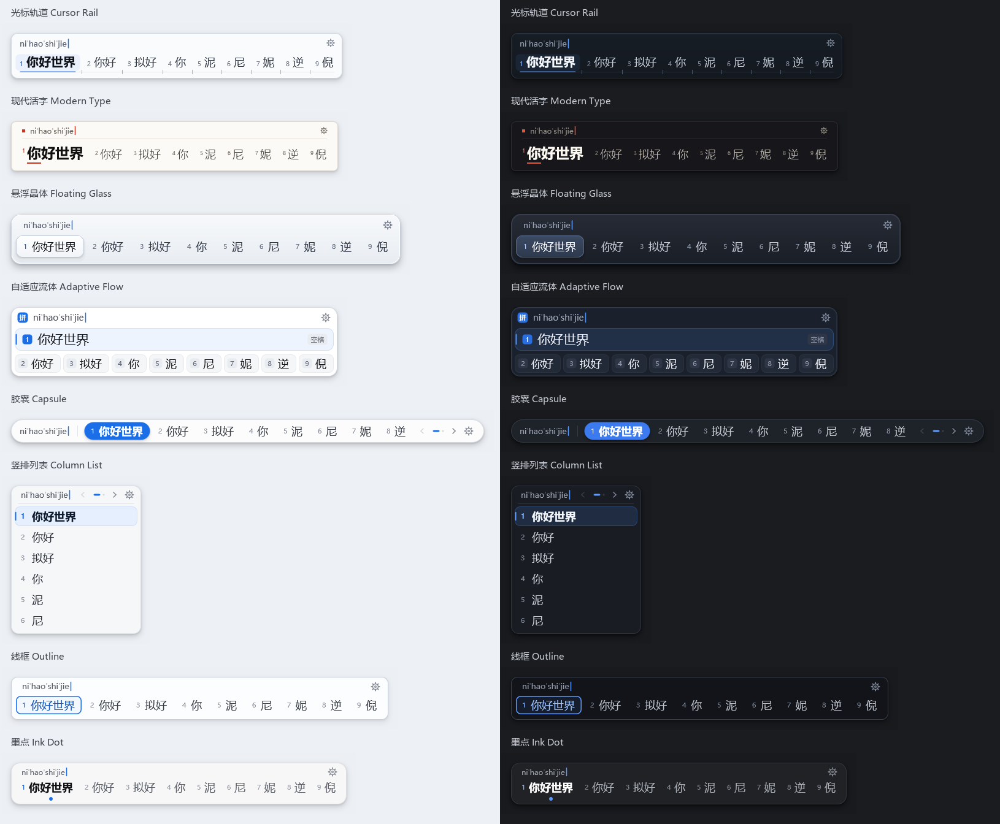
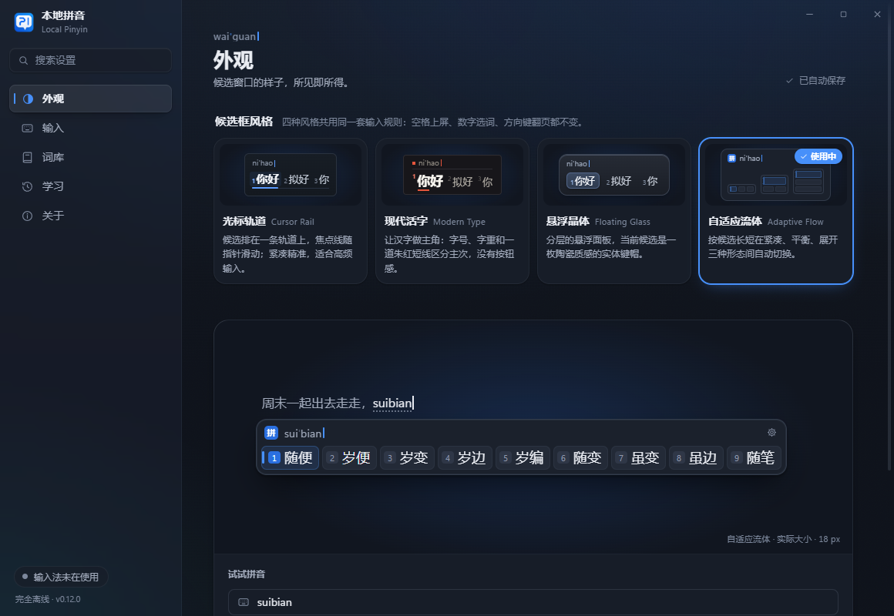
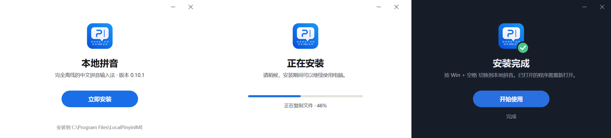
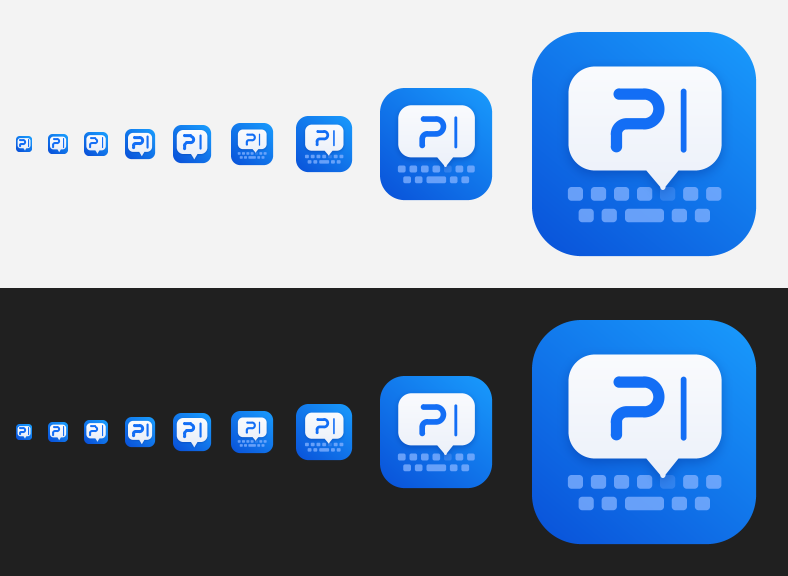

# 本地拼音 0.20.1

Windows 10/11 x64 离线中文拼音输入法。输入核心是原生 C++20 / Windows TSF，设置界面和工具面板使用 Electron、React、TypeScript 和 Vite。关闭设置后设置程序退出（工具面板用过后 10 分钟退出，可以设成在后台待命），输入核心继续独立工作。安装包自带运行时，打字时不联网，也不需要另外安装 Node.js 或 Python；设置程序会检查 GitHub 上有没有新版本（可以关闭）；开启“Tab 键翻译成英文”后，按 Tab 时会联网翻译。

## 0.20.1 小面板：CapsLock 切换分类，剪贴板放大查看

- **换页和换分类分开**：Tab 切换上面一排（工具、剪贴板、符号……），CapsLock 切换下面一排分类，Shift+Tab、Shift+CapsLock 反向，到头后从另一头接着。两排右端各有一个小小的“Tab”“Caps”提示。面板里按 CapsLock 不会改变大小写状态。
- “最近使用”分类改为时钟图标。
- 剪贴板和记录里的数字编号加深，在各种候选框风格里都看得清。
- **剪贴板放大查看**：每条记录右端有放大镜，点一下（或按 →）查看完整内容：长文字全部显示，可以用 ↑↓ 滚动；图片放大显示，旁边列出图里识别到的文字。Enter 粘贴，← 或 Esc 返回。
- 剪贴板列表里的图片只显示“图片 宽×高”，识别出的文字放到放大查看里（仍然可以用它搜索）。
- 大窗口的“添加短语”只能添加英文短语（如 dollar → $）；中文词直接打拼音就能找到。

## 0.20.0 轻量工具面板，全键盘操作；新增“记录”

- **连按两下 Tab 打开的面板改为轻量小窗**：由输入法自己画在光标旁，和候选框同一套样式，不再启动单独的程序，按下马上出现；焦点留在原来的输入框。
  - 全部可以用键盘操作：Tab / Shift+Tab 换页，方向键移动，数字键选当前一行（符号、表情可以连着选几个），Enter 输入，Backspace 去掉最后一个，Esc 关闭；`[` `]` 切换分类，PageUp/PageDown 或 `-` `=` 翻页，Ctrl+D 收藏。
  - 直接打拼音就能搜索：meiyuan → $，kaixin → 开心的颜文字和表情；剪贴板和记录也一样。
  - 右上角的放大图标（或 Shift+Enter）换成原来的大窗口，停在同一页；大窗口里可以拖入表情包、添加短语。
  - 剪贴板里的图片、表情包在小窗里直接显示缩略图；表情包和图片用粘贴发送。
- **新增“记录”**：存地址、账号密码、银行卡号，或任何想再次输入的内容，按“密码 / 地址 / 其他”分类（账号密码默认带邮箱/账号、密码、网址、备注，地址带收件人、电话、地址、邮编，每一类都能再加项）。
  - 第一次打开时可以设一个密码，也可以不设：设了密码，用密码加密；不设，用这台电脑的 Windows 账户加密。文件里没有明文。
  - 小窗里输入密码解锁后，5 分钟内不再询问；选一条记录再选一项，Enter 输入到光标处，Ctrl+C 复制（不进剪贴板历史，45 秒后自动清除）。
  - 大窗口里添加、改标题、修改、删除；“设置 › 工具面板 › 记录”里设置、修改、取消密码，或删除全部记录（忘记密码时只能这样）。
  - 导入导出新增“记录”一项（只能覆盖，因为内容是加密的）。
- 候选里的表情（😄 等）改为彩色显示。

## 0.19.0 工具面板：符号、颜文字、表情、表情包、剪贴板和小工具

- **连按两下 Tab 打开工具面板**，面板出现在光标旁边，选好的内容输入到原来的位置；只按一次 Tab 还是普通的 Tab（或翻译）。左侧六页：
  - **工具**：输入框里打什么马上转换——数字计算（55+15 → 70）、大小写（123 → 壹佰贰拾叁）、日期（12.19 → 十二月十九日）、当前时间（sj → 2024-03-19 14:27:45）。在任何输入框里先打 v 再输入这些（v55+15），候选里也有结果；sj、rq、xq 直接打就有时间、日期、星期。
  - **剪贴板**：记住复制过的文字和图片，按时间排列，可以搜索（图片里的文字也能搜到，用 Windows 自带的文字识别）、按日期查看，图片点开放大，点一下粘贴回去。安装或更新后先问你要不要开启；只保存在本机，密码管理器等标记为不记录的内容会跳过；保存 1 天到永久可选，可以清空。
  - **符号**：常用数学符号、常规标点、货币、拉丁（含拼音声调）、数学、希腊字母、箭头、几何和其他 Unicode 符号，共约 3,100 个；分类栏可以左右滑动、点击跳转，可以按中文名搜索（美元 → $）。
  - **颜文字**：1,000 个，按开心、喜欢、难过、生气、惊讶、害羞、无语、打招呼、跳舞唱歌、睡觉、动物、动作分组。
  - **表情**：约 1,870 个常用表情，最上面是最近用过的，可以按中文搜索（猫、爱心）。在面板里用过的表情，之后打它的名字时排在第三个候选（kaixin → 😄），可以关闭。
  - **表情包**：把图片或动图拖进框里（或点框选择文件）就添加了，点一下发送，可以删除。
  - 符号、颜文字、表情点一下先放进底部，可以连续选几个，按“确定”一起输入；右键收藏；“添加短语”把它和几个词绑定（$ 绑定“美元”“美刀”），以后打这些词它排第一，选了别的也只退到第二，直到在“学习 › 输入习惯”里删掉。
- **设置**：新增“工具面板”页（连按两下 Tab、后台待命、表情候选、剪贴板开关与保存时间）；“学习”页新增“输入习惯”，可以添加和删除；“关于”页新增**导入与导出**：快速导出全部，或选择设置、个人词库、选词记录、输入习惯、面板收藏、表情包、剪贴板记录中的几项；导入时每一项可以选合并、覆盖或跳过。
- 修复：RichEdit 类程序（写字板等）里一个 Tab 被发回程序后，之后的 Tab 都直接给了程序，双击 Tab 和翻译都不起作用。
- 符号、表情的中文名来自 Unicode CLDR（Unicode License v3），颜文字来自 emoticon-data（MIT），见 `resources/THIRD_PARTY_NOTICES.txt`。

## 0.18.2 选词记忆会慢慢淡去；荧光笔深色模式看不清字

- **选词记忆会慢慢淡去**：选过的词（包括造词，例如分别打出“量”“甲”“成”后的“量甲成”）先排第一，之后每过一个周期往后挪一位，挪 4 次后按原本的顺序排。第一次选的周期是 3 天；隔 12 小时以上再选一次，马上回到第一，而且周期乘以 2.5（7.5 天、约 19 天……最长半年），用得越久越不容易被挤下去。同一段时间里连着选只算刷新。规则见 [INPUT_FEATURES](docs/INPUT_FEATURES.md#选词记忆会慢慢淡去0182)。
- **荧光笔在深色模式下看不清字**：黄色笔触只盖住字的下半部分，整个字却用了笔触上的深色墨，露在笔触上面的部分在深色背景上看不见。现在笔触外面用页面本身的浅色字，只有笔触里面是深色字；设置程序的预览和缩略图也一样。

## 0.18.1 Tab 翻译在实际程序里可用

- **0.18.0 的 Tab 翻译在实际程序里没有反应**：测试用的文档能读写，实际程序不一样。
  - 用 RichEdit 的程序（写字板、新版记事本等）问不到“这是不是密码框”时，输入法就不读光标前的文字，所以找不到要翻译的内容。现在问不到就照常读取（密码框本来就会让输入法进入安全模式）。这个问题也让“根据前文排列候选”在这些程序里一直没起作用，这次一起修好了。
  - 老式 Win32 程序（经 Windows 兼容层）根本不让输入法读到已经上屏的文字；而且它们自己打的键（数字、空格、回车、方向键）只询问输入法、不通知按下，输入法记不住。现在在询问时就记下这些键；替换改为按原文字数发送退格，再把英文打进去。
  - 在程序里点鼠标会结束这一段，防止光标被鼠标挪走后删错字。
  - 用 RichEdit 和老式 Win32 输入框实测：nihao 空格 Tab → Hello；你好，世界 → Hello World；我有3个 → I have 3；回车或点鼠标之后按 Tab，只插入制表符，不删字。

## 0.18.0 Tab 键翻译成英文

- **Tab 键翻译成英文**：打完一段中文按 Tab，这段中文换成英文（我想吃饭 → I want to eat）；还在打拼音时按 Tab，先上屏再翻译。
  - 翻译的是从上次放下光标开始打的那一段，按 Tab 前先核对文档里确实是它，点到别处、改过就不翻译，Tab 照常给程序。
  - 用谷歌翻译的公开接口，不需要密钥；只在按 Tab 时把这一段发出去，其余输入始终在本机，密码框里不翻译。
  - 默认关闭，在“输入”页“候选”里打开；打开后 Tab 归翻译用，联想不显示。规则见 [INPUT_FEATURES](docs/INPUT_FEATURES.md#tab-键翻译成英文0180)。

## 0.17.0 自动检查更新；标点开关拆分；自动造词

- **自动检查更新**：打开设置程序时检查 GitHub 上有没有新版本，最多每 12 小时一次；“关于”页显示新版本号、发布日期和更新说明，侧边栏的“关于”上出现“新版本”标记。
  - 点“下载新版本”后，下载安装包并用发布页上的 SHA-256 文件校验，不一致就删除并提示；点“立即安装”启动安装程序，设置程序随即关闭。
  - 只读取版本信息、下载安装包，不上传任何内容；“自动检查更新”可以在“关于”页关闭。
- **辅助功能拆成三个开关**：
  - “数字后打。变成 .”（3.14）；
  - “数字后使用英文标点”（1,000、1/2、12:30）；
  - “字母后使用英文标点”（Hello, world.，默认关闭）。

  旧版本里关掉过“数字后使用英文标点”的，升级后前两项都保持关闭。
- **自动造词**：一个字一个字打出的词，下次可以整个打。例如分别打出“量”“甲”“成”之后，输入 liangjiacheng，“量甲成”就是第一个候选。规则见 [INPUT_FEATURES](docs/INPUT_FEATURES.md#自动造词0170)。
- **自适应流体重新设计**：当前候选变成一滴蓝色的液体，盖住的字是白的。
  - 指针移到别的候选、方向键换词、打字时首选变长变短，水滴都是流过去的：前面先到，后面跟上，中间收腰，再聚成一滴，表面的光泽跟着晃。
  - 候选窗口出现时水滴从左往右倒满，变了的候选一个接一个浮上来。
  - 三种形态（紧凑、平衡、展开）照旧按候选长短自动切换；候选不再画底框，查询栏的“拼”字换成一枚水滴。规格见 [DESIGN_SYSTEM §7.6](docs/DESIGN_SYSTEM.md#76-自适应流体-adaptive-flowflow默认)。
- **候选窗口第一次出现在别处**：有时候选窗口先出现在鼠标或别的位置，打完一次才回到光标下。
  - 原因多半是：不少应用（浏览器、基于 Chromium 的桌面应用等）要等收到按键之后才排好新文字的位置，第一个键时输入法拿不到位置，只能退而用系统光标或上一次的位置。
  - 现在输入法会监听应用的“排版完成”通知，并在窗口出现后的 0.3 秒内再核对几次位置，偏了就挪到文字下方。
  - 应用还没排好版时，先等一下它的通知，不在猜测的位置闪一下；同一次输入中，后面的键继续用应用上一次给出的位置，不再跳到系统光标那里。
- **重新安装同一版本不再失败**：以前已经装着某个版本时再装一次同一版本，会因为输入法文件正被打开的程序使用而失败并回滚。现在这些文件先改名挪开（重启后删除），已经打开的程序继续用旧文件，之后打开的程序用新版本。

## 0.16.0 两种新候选框风格：翻牌、荧光笔；补齐零碎日常词

- **翻牌 Split-Flap 和荧光笔 Highlighter 替换了线框和墨点**：
  - 翻牌像机场的航班牌，一个字一块翻页牌，当前候选是一排琥珀色的牌。候选变化时，只有字变了的牌从左往右一块块翻过来：多打一个字母，没变的字不动，只翻新的字。
  - 荧光笔是一张笔记纸，当前候选被荧光笔划了一道：斜切的扁头笔痕，边缘有手绘的起伏，笔触下的字变成深墨色。指针移到别的候选上，笔触滑过去；换词时从左往右重新划一笔。深色模式也是亮黄笔触配深色字。
  - 选过线框或墨点的设置会回到默认的“自适应流体”。
- **补了 7,994 个词**（第二轮补词，批次 148–162，词库 210,948 → 218,942 条）：
  - 日常零碎词 4,954 个：学校与数学、家居日用、饮食、身体健康、购物与生活服务、出行天气、职场口语、网络用语、游戏娱乐；
  - jieba 词频表排名 3–10 万里的四字成语和长谚语 2,865 条；
  - 日常聊天短句 175 条，例如干嘛呢、信你个鬼、转我、爱咋咋地。

  0.15.0 时抽查的 19 个词里有 7 个根本打不出来（式子、算式、竖式、演草纸、甩锅、背锅、氪金），现在单独输入 18 个在前九。新词单独输入 99.9% 在前九、92.6% 是首选。
- **场景词表补充**：例如“数学理科”加了式子、算式、竖式、余数、约分等中小学说法。选中后数学词表的词全在前三，式子是首选。
- **前文之后先列整词**：在“但是”后面打 shizi，以前候选里混着“是自”“是紫”“是资”，式子挤不进前九；现在从第二个起先列整词（狮子、十字……式子），首选仍按前文判断。
- **lue 和 lve 都能打**：略、虐这类字打 lue、nue 或 lve、nve 都行，不管词库里写的是哪种；以前词库里写成 lve/nve 的 119 个词，打 ue 只能找到 92 个。
- **日常聊天**：前文模型加入一份项目原创的即时聊天文本，并新建两组日常聊天测试句。所有测试集都没有下降，留出整句首选 57.71% → 58.05%。新建的日常口语留出集没有可测的提升（首选少对 1 句、前九多对 1 句，共 150 句），原因和试过的做法见 [CONTEXT_MODEL](docs/CONTEXT_MODEL.md#日常聊天0160)。

## 0.15.0 八种候选框风格；设置打开更快；安装不卡顿



- **新增四种候选框风格**，同样是现代简约的路线，原来四种不变：
  - **胶囊 Capsule**：整个窗口是一条圆角长条，拼音在左端，一道细线隔开，候选紧随其后；当前候选是一枚实心蓝色胶囊。只有一行，是最矮的候选窗口。
  - **竖排列表 Column List**：候选一行一个，像菜单一样竖着排，每页最多 6 个，长词和整句完整可读；当前行是浅蓝底加左侧短竖条。翻到最后一页时窗口高度不变。
  - **线框 Outline**：平整的面板加一圈清晰细边，几乎没有阴影；当前候选只用一圈蓝色描边和蓝字标出，不填色、不加粗。
  - **墨点 Ink Dot**：只有文字；当前候选略粗，下方一颗蓝色小圆点，指针移到别的候选上时圆点跟着滑过去。
- **风格卡片可以左右翻**：外观页一次显示四张，点两侧的箭头翻到另外四张，下方圆点表示第几组。点“更多”打开全部风格页，八款四个一排，各带一句介绍，点选即用。
- **预览只做预览**：外观页去掉了“试试拼音”输入框，舞台显示固定的示例（sui'bian），跟随所选风格、字号和主题，仍可翻页。
- **设置打开更快**：预览不再启动输入引擎查词；读取设置时词库只统计条数（650 → 约 365 毫秒），并且和 Electron 启动同时进行。打包后的设置程序从启动到外观页完整显示，由约 2.4–3.1 秒缩短到约 1.0–1.1 秒（同一台电脑，各测 6 次）。
- **点“立即安装”不再“未响应”**：解压约 110 MB 的安装数据、启动安装程序和统计已复制的文件都改到后台线程，安装窗口保持响应，进度照常更新。

## 0.14.3 设置页更简洁；数字后的逗号和斜杠；切换时保留字母

- **设置页**：说明文字默认收起，每个设置只显示名称和开关；点名称旁的 ⓘ 图标展开说明，常用功能配有动画演示（拼音打出、候选出现、上屏），系统开启“减少动画”时只显示静止画面。“试一试”试用区已移除。
- **数字后使用英文标点**（原“数字后输入小数点”）：数字后面的句号、逗号、斜杠和冒号都是英文半角：3.14、1,000、1/2、12:30。
- **切换中英文时保留字母**：打了几个字母才发现在中文模式，按 Ctrl+Space（或 Shift）切换时，这些字母按原样留在文中，不再消失。

## 0.14.2 32 位程序可以使用；辅助功能

- **32 位程序**：之前只安装了 64 位输入法，QQ 音乐等 32 位程序（不少腾讯、网易的桌面软件都是 32 位）根本切换不到本地拼音。安装包现在同时安装 32 位输入法（`x86\` 子目录，与 64 位共用同一份词库和设置），安装时在 32 位注册表视图里另外注册并验证。
- **辅助功能**（“输入”页，默认开启，可分别关闭）：
  - 数字后输入小数点：数字后面按句号键打出“.”（3.14、v1.2），其他地方仍是“。”；
  - 编程软件中使用英文标点：在 VS Code、Cursor、Visual Studio、JetBrains 系列、Android Studio、Sublime Text、Notepad++ 和终端里，标点按英文半角输入（< ( { [ ! ? ,）；没有在打拼音时按键直接交给编辑器，保留它的自动配对括号。

## 0.14.1 前文模型加入口语对话

前文模型原来主要用新闻和书面句子训练，口语字词估得偏低。现在加入两份清华大学 CoAI 组公开的对话语料（KdConv 闲聊、CrossWOZ 办事对话，Apache-2.0），安装包里只有统计数据、没有原句。不选任何场景时，“这种又是 zalaide”也首选“咋来的”，zane 首选“咋呢”。新的口语对话测试集只收训练里没出现过的句子：闲聊部分首选从 49.7% 升到 72.5%，书面整句从 58.07% 降到 57.71%。来源、测量和取舍见 [CONTEXT_MODEL](docs/CONTEXT_MODEL.md#口语对话语料0141)。

## 0.14.0 常用场景

“输入”页新增“常用场景”：编程开发、办公职场、数学理科、学习考试、日常聊天、游戏娱乐，可以多选。每个场景是一份整理好的词表，选中后其中的词在单独输入和整句里都排得更靠前，词库里没有的场景词也会出现；展开“场景词条”可以看到所选场景的全部词语。例如选“日常聊天”后，haoxiangshi 首选“好像是”，“所以整道题 qishi”首选“其实”；选“编程开发”后 yilaizhuru 直接给出“依赖注入”。不选场景时与之前完全相同。做法、词表来源和对通用文本的影响见 [INPUT_FEATURES](docs/INPUT_FEATURES.md#常用场景0140)。

## 0.13.3 常用词不再排在生僻同音词后面

项目词库的分数是粗档，不少最常用的词被放在低档（公司、信息、会议 3000，其实、好像 7000），排在只有标准词库收录、带着更高数值的生僻同音词后面：qishi 首选“七十”、zheyang 首选“遮阳”、jiushi 首选“九十”。现在标准词库的频率作为下限，项目里更高的分数（有意设定的优先级）保持不变。

| 测试集 | 用例 | 0.13.2 首选 | 0.13.3 首选 |
| --- | ---: | ---: | ---: |
| 逐词输入·无前文（新增这一组） | 20,626 | 73.71% | 77.99% |
| 逐词输入·参考前文 | 20,626 | 86.04% | 86.04% |
| 留出整句 | 4,126 | 58.07% | 58.07% |

带前文的整句解码本来就使用标准词库频率，所以其余各组结果不变。“无前文”指单独输入一个词，例如文本框里的第一个词，或者应用不提供前文的时候。`accuracy_snapshot.py` 增加了这一组。

仍然存在的问题：前文模型主要来自新闻语料，口语字词（咋、其实接在“题”后面）的接续估计偏低，例如“这种又是 zalaide”首选“杂来的”，“所以整道题 qishi”首选“歧视”。选过一次后会按个人习惯排在前面；根本改善需要补充口语语料。

## 0.13.2 打开安装包时请求管理员权限

安装包的图标带盾牌标记，管理员账户双击时系统先弹出权限确认，点“是”后才出现安装窗口，点“立即安装”后不再中途弹窗。标准用户账户仍按原方式在点“立即安装”时输入管理员密码，这样输入法会启用在当前登录的账户里。安装完成后点“开始使用”，设置程序以普通权限打开，不继承安装程序的管理员权限。

## 0.13.1 输入设置改为设置列表

“输入”页不再用带插图的功能卡片，改成分组的设置行：中英文切换、候选、拼写、输入方案。开关在每行右侧，一句说明讲清它做什么；输入方案用选择器；模糊音和双拼键位图收在可展开的行里，收起时直接显示当前状态（如“已开启 2 项”）。所有设置项和保存方式不变。

## 0.13.0 更聪明的输入

这一版改进按键怎样读成候选，选词、翻页、上屏和学习的操作都不变。设置在“输入”页的“拼写”和“输入方案”两组，说明和测量见 [INPUT_FEATURES](docs/INPUT_FEATURES.md)。

- **拼写纠错。** 多打、漏打、颠倒或按到相邻键时推荐正确的词：nihso → 你好，xihaun → 喜欢，整句中间打错也能纠正。读得通的输入保持原读法在前，例如 zhida 首选“直达”、第二个是“知道”。模糊音式的读音混淆不算误触。可以关闭。
- **中英混输。** 拼音里直接夹英文单词、编程术语和缩写：woyongpythonxiedaima → 我用 Python 写代码，ppt → PPT。能读成拼音的英文词不会打断中文。可以关闭。
- **模糊音。** z=zh、c=ch、s=sh、n=l、f=h、r=l、an=ang、en=eng、in=ing、ian=iang、uan=uang，逐项开启：开启 z=zh 后 zongguo → 中国。
- **简拼与双拼。** 简拼始终可用（bjdx → 北京大学，zh/ch/sh 可两字母输入）；新增小鹤双拼和自然码，设置页显示键位图，候选窗口显示换算后的全拼。
- **整句输入。** 重新校准句尾判断和切分代价：留出整句首选 57.3% → 58.1%（测试半集 58.0% → 59.0%），逐词输入不受影响，打字延迟不变。

## 0.12.0 四种候选框风格

外观页新增“候选框风格”，四种风格可随时切换，选好即保存，并直接作用于实际输入时的候选窗口。四种风格共用同一套输入规则：空格上屏、数字选词、方向键翻页、Esc 取消、联想与学习都不变。规格见 [DESIGN_SYSTEM §7](docs/DESIGN_SYSTEM.md#7-候选窗口)。

- **光标轨道 Cursor Rail。** 候选沿一条带刻度的轨道排开，当前候选放大加粗，一道焦点线压在轨道上，随指针滑动；多页时下方的页轨显示当前位置。
- **现代活字 Modern Type。** 以汉字为主角：当前候选大一号、粗体，其余为细体，全部落在同一条基线上，配小号上标数字和一道朱红短线，没有按钮和色块。
- **悬浮晶体 Floating Glass。** 分层的悬浮面板，当前候选是一枚有边缘、顶光和接触阴影的陶瓷键帽。用不透明的分层材质模拟晶体，保证文字在任何背景上清晰。
- **自适应流体 Adaptive Flow（默认）。** 按候选的实际宽度在紧凑、平衡、展开三种形态间自动切换，形态切换有迟滞，不会每输入一个字母就变形；拼音始终对准插入点。
- **设置与预览。** 四张卡片显示各风格的真实缩略图；舞台用真实输入引擎的候选实时预览所选风格，字号与主题照常独立调整，主题小样显示所选风格。
- **系统设置。** 关闭“动画效果”时焦点不再滑动，高对比度模式改用系统颜色。

## 0.11.0 候选窗口：命令面板

候选窗口不再是一条横向列表，而是按命令面板的方式重新组织。输入逻辑不变：空格上屏当前候选，数字键选词，左右方向键翻页，联想时按 Tab 接受。规格见 [DESIGN_SYSTEM §7](docs/DESIGN_SYSTEM.md#7-候选窗口)。

- **三个区域。** 顶部查询栏放“拼”字品牌标记、拼音和插入符，翻页与设置齿轮收在它的右端；中间的焦点行是当前候选；下面一排 chip 是同页的其他候选。
- **焦点行是视觉中心。** 不再只靠一块蓝底：候选放大 1.17 倍，浅强调色底加细描边，左缘一道品牌插入符竖条，编号键帽为强调色，右端的提示键帽写明“空格”（联想时为“Tab”）。
- **chip 候选。** 每个候选是带编号键帽的小 chip，悬停和按下各有状态。每页从当前候选开始，翻页时不会重排。
- **克制的材质。** 去掉上一版的渐变选中键和光晕，保留双线玻璃边和两层柔和阴影，深色模式顶部加一道亮线。
- **设置同步。** 外观页的预览、主题小样和各页插图里的候选窗口缩样都换成新结构，与原生窗口按同一份规格绘制。

## 0.10.1 精修：墨与纸

- **材质。** 浅色模式改为微暖的纸白配蓝墨，深色模式改为提亮的蓝黑墨色，由三束环境光照亮，并加了细颗粒材质；表面顶部有高光，不再是大片单调的黑色。
- **连续而不割裂。** 边框减弱为细线。输入页的四个功能合成一整块面板，词库页的指标和词语列表合成一张“账簿”，模块之间不再一块块断开。
- **候选窗口。** 外侧细边加内侧亮边构成双线玻璃边；选中键改为由亮到深的渐变，加顶部亮边和光晕；编号键帽与插入符保持不变。
- **响应式。** 页面宽度随窗口增长到 1240，最大化时各页构图横向展开（检查器在舞台旁、功能排成一行、数字与流程并排），舞台高度随窗口变化；最小窗口与 150% 缩放下也经过测试。
- **字体与信息密度。** 标题、数字和行高整体收紧，次要文字对比度提高到 4:1 以上。拼音改用正文字体，去掉了键帽式搜索提示和导航快捷键标记，摆脱开发者工具的观感。

## 0.10.0 设计语言

这一版重新确立了整体的视觉语言和页面构图，所有功能与输入逻辑不变。规范见 [DESIGN_SYSTEM](docs/DESIGN_SYSTEM.md)。

- **插入符是品牌符号。**
  - 图标“P|”中的文字光标贯穿全产品：候选窗口拼音行的末尾、每页标题上方逐字“打出”的拼音小标题（如 `wai'guan|`）、导航和命令面板的选中标记。
  - 拼音分隔符“'”在各处都比音节浅一级。
- **候选窗口成为主角。**
  - 窗口分上下两色：输入带显示拼音和插入符，下方是候选。
  - 编号画成小键帽，提示按 1–9 选词。
  - 选中项像一颗发光的按键：内凹键帽、浅色顶边、同色光晕。
  - 分页不超过三页时显示为分页点。
  - 原生窗口与设置里的预览按同一份规格绘制。
- **按内容类型构图，不堆卡片。**
  - 外观页是“舞台 + 检查器”：聚光舞台上按实际大小显示候选窗口，玻璃检查器里有试拼音、主题小样（小样本身就是候选窗口）和字号滑块。
  - 输入页是带插图的拼贴格、打字实验台和键帽图例。
  - 词库页是指标带加数据集。
  - 学习页用主数字和三步流程，讲清“选择 → 记住 → 下次排第一”。
  - 关于页是品牌页。
- **光与材质。**
  - 中性色改为带蓝的墨色，画布由品牌蓝和品牌青两束环境光照亮。
  - 侧边栏、检查器和命令面板是磨砂玻璃，表面带顶部高光。
  - 深色模式不再是一片平淡的黑灰色。
- **更轻的导航与标题。**
  - 去掉了整条标题栏：品牌只出现一次，搜索放进侧边栏，窗口按钮悬浮在右上角。
  - 导航选中块会滑动，插入符到达时闪一下；页面切换、开关、分页点、条形图和对话框都有细腻的状态过渡。
- **一份令牌，三个界面。** 颜色、圆角、字号和动效定义在 `assets/branding/theme/design_tokens.json`，同时生成设置程序的 CSS 和原生界面的常量，测试会检查两者是否一致；Ctrl+K 命令面板与 Ctrl+1–5 快捷键保留。



## 0.8.4 词库扩充

- 新增 1,642 条词（批次 135–147）：补齐《通用规范汉字表》一级全部缺字与二级 650 个缺字（单字按标准读音可打），常用的机构、地名、历史与思想用语、普通词语、成语，以及时事新词、港台用语和科技新词。最常用 1 万词的收录率 91.3% → 95.6%。
- 五个测试集首选率均不低于 0.8.3（逐词输入 85.95% → 85.98%，留出整句 57.22% → 57.27%）。详见 [LEXICON_COVERAGE](docs/LEXICON_COVERAGE.md)。
- 引擎按“字”而不是 UTF-16 单元判断多字词，扩展 B 区汉字不再被当作两字词加分。扩展区汉字暂不收入词库，待前文模型支持后加入。

## 0.8.3 修正

- 安装程序在安装完成后停在 100% 不动（安装本身已成功）：安装进程结束的状态只在一次刷新里有效，下一次就丢失。现已修正。
- 等待管理员权限确认期间，进度停在 0 并提示在弹出窗口中选择“是”，不再假装在复制文件；拒绝或超时后说明原因，可重试。
- Microsoft Store 应用中的候选窗口已在 Notepads 中实机确认显示正常。

## 0.8.2 更新

- **候选框设置按钮。** 候选窗口右侧新增齿轮按钮，点击打开设置（Microsoft Store 应用中不显示，那里无法启动外部程序）。
- **选词记忆修正。** 对同一串拼音，最近选过的词排到最前，选得越近越靠前、次数多的其次。此前输入 annui 时“安徽”永远第一：annui 不是标准拼音，候选来自拼写容错，学习加分追不上容错扣分；现在学习记录直接决定顺序，不再与打分相加。保存学习记录和个人词库时，若文件正被杀毒软件或索引服务短暂占用，会稍等后重试，不再偶尔丢失一次保存。
- **新的安装程序。** 单窗口、无系统边框，图标、标题、一个“立即安装”按钮，进度条和完成页，跟随浅色/深色主题与显示缩放。复制、注册与启用仍由经过验证的 Inno Setup 包在后台静默完成（会弹出一次管理员权限确认）。
- **词库覆盖率评估。** 见 [LEXICON_COVERAGE](docs/LEXICON_COVERAGE.md)：一级常用字 99.6%，最常用 5,000 词 95.9%，日常句子约九成的词直接在词库中。



## 0.8.1 修正

- CapsLock 开启或按住 Shift 时，字母直接输出大写；正在输入拼音时，大写字母按原样加入输入串，候选为原样文字，空格上屏。
- Microsoft Store（UWP）应用中，候选窗口以输入框所在窗口为所有者创建，避免被系统隐藏。

## 0.8.0 更新

**更准的前文排序。** 新的字符 4 元语言模型（插值修正 Kneser-Ney，约 1,030 万字统计、15.6 MB、内存映射共享）取代了原来约 20 万字的计数打分。输入新拼音时，候选按光标前已经输入的文字排序：“他跑”之后输入 de 首选“得”，“没有”之后输入 shijian 首选“时间”。在与训练数据分开的测试集上：

| 测试集 | 0.7.9 首选 | 0.8.0 首选 |
| --- | ---: | ---: |
| 逐词输入（有前文，10,466 例） | 71.3% | 85.7% |
| 留出整句（2,082 例） | 30.1% | 56.0% |
| 项目原有四组整句用例（299 例） | 56.5% | 66.6% |

前文对首选的贡献从 1.1 提高到 12.2 个百分点。不能读取光标前文字的应用，改用本输入法刚在同一输入框上屏的文字作为参考（仅在内存中，短时有效）。详见 [前文语言模型](docs/CONTEXT_MODEL.md)。

**联想改为可选。** 上屏后自动推荐下一个词的“联想”默认关闭，可在设置的“输入”页打开；0.7 保存的旧设置不会自动打开它。见 [前文排序与联想](docs/CONTEXT_PREDICTION.md)。

**新的候选窗口。** 上方显示带音节分隔的拼音（如 `ni'hao'shi'jie`），下方单行候选，选中项为蓝色；圆角抗锯齿并带柔和阴影（逐像素透明窗口），跟随浅色/深色主题。候选多于一页时显示左右翻页按钮。

**图标更清晰。** 保持原有“对话气泡 + P| + 键盘”设计，重新绘制为矢量并逐尺寸渲染；32 px 及以下省略键盘、放大气泡，P 对齐整像素。任务栏的“中/英”指示改为按系统真实 DPI 运行时绘制，跟随任务栏浅色/深色与高对比度主题。



**重做的设置界面。** 分组设置、与真实候选窗口一致的实时预览，以及“参考前文 / 不参考前文”对比试用（0.10.0 起采用新的设计语言）。


## 安装与使用

运行安装包后按 Win＋空格选择“本地拼音”。升级后重新打开正在输入的应用。

- CapsLock 开启或按住 Shift 时输入大写英文字母。
- 空格确认当前候选，数字 1–9 选择当前页对应候选，左右箭头翻页，Esc 取消，Enter 上屏原始拼音。
- Ctrl＋Space 切换中英文；可在设置中打开“按 Shift 切换中英文”。
- 支持全拼、连续拼音与整句候选、简拼、补全、单次拼写容错、中文标点、鼠标选词、个人词库和本地学习。长句和同音词仍可能需要选词。

## 构建

需要 Visual Studio C++ 工具和 Windows SDK、CMake/Ninja、Python 3、Node.js 22.12 或更高版本及 Inno Setup 6。

```powershell
powershell -NoProfile -ExecutionPolicy Bypass -File .\scripts\Build.ps1
```

脚本构建并测试原生组件、安装前端依赖、编译 Vite 与 Electron、打包桥接与运行数据，在 dist 中生成安装包及校验文件：先用 Inno Setup 生成负责复制与注册的内层包，再把它嵌入安装界面 `LocalPinyinInstaller`（`src/installer`）。`LocalPinyinInstaller.exe --preview` 模拟一次安装而不改动系统，`--capture <目录>` 把各状态渲染为 PNG；这两种模式不需要管理员权限，先设置环境变量 `__COMPAT_LAYER=RunAsInvoker` 即可以普通权限运行。首次需要联网下载依赖和 Electron。desktop 中运行 `npm ci` 与 `npm run dev` 可开发设置界面（需先构建原生桥接）。

语言模型与图标的生成脚本：`tools/fetch_context_corpus.py`、`tools/build_context_lm.py`、`tools/generate_brand_icon.py`、`tools/generate_mode_icons.py`；生成时使用的 Python 包不进入安装包。补词时用 `tools/export_lexicon_gaps.py` 导出缺字缺词清单，用 `tools/accuracy_snapshot.py` 对比补词前后各测试集（含无前文一组）的准确率。补词任务的完整规则与流程见 [LEXICON_EXPANSION_TASK](docs/LEXICON_EXPANSION_TASK.md)。

## 数据与验证

个人设置、词库、学习、输入习惯、表情包（stickers）和剪贴板记录（clipboard）保存在 `%LOCALAPPDATA%\LocalPinyinIME`；Electron 缓存和面板收藏在其中的 desktop 子目录。剪贴板记录由 `LocalPinyinClipboard.exe` 在开启时后台运行（登录时自动启动，关闭开关即退出并取消自启）。学习最多保存 2,048 条记录；清除学习保留个人词库，卸载保留个人数据。前文查询都在本机完成。

43 项原生测试（含跨进程桥接、真实 TSF 编辑会话、八种候选框风格的布局与分页、拼写纠错/模糊音/混输/双拼/常用场景、前文模型、剪贴板记录、记录加密、小面板按键逻辑与设计令牌一致性）、26 个设置程序流程和 11 个大窗口流程通过；连按两下 Tab 打开小面板、用键盘选择和搜索后输入到光标处、放大成大窗口，在 RichEdit 和老式 Win32 输入框里实测通过。未做干净机器上的完整安装卸载验收。兼容范围见 [COMPATIBILITY](docs/COMPATIBILITY.md)。

## 许可

项目代码、原创词库与联想关系采用 MIT；标准词库为 Apache-2.0。前文语言模型只包含统计数据，来源包括 Tatoeba（CC BY 2.0 FR）、中文维基新闻（CC BY 2.5）、Mozilla Common Voice（CC0）与项目原创及公有领域语料，署名见 `resources/THIRD_PARTY_NOTICES.txt`。上游页面标题整理的名称索引有独立来源记录，不统一声称 MIT 授权，参见 [历史来源审计](docs/remote-lexicon-audit-074.md) 及 [此前上游审计](docs/remote-lexicon-audit-076.md)。Electron/React 采用 MIT。
