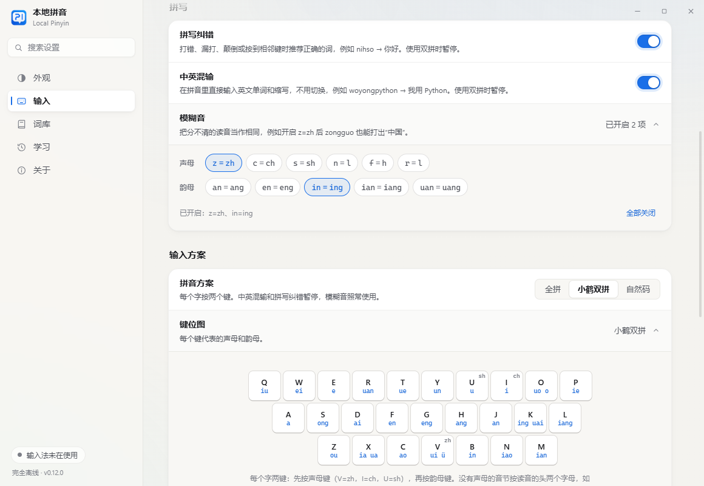

# 常用场景、拼写纠错、中英混输、模糊音、简拼与双拼

0.13.0 起，输入核心在把按键变成候选之前多做了几件事。它们都只改变“按键怎样读成候选”，不改变选词、翻页、上屏、学习等任何操作。设置在“输入”页的“常用场景”“拼写”和“输入方案”三组里：常用场景是多选卡片，纠错和中英混输是开关，模糊音收在可展开的“模糊音”行里多选，双拼用“拼音方案”选择器，键位图在它下面展开。设置保存在 `settings.json` 的 `inputMode` 下：

| 设置 | 键 | 默认 |
| --- | --- | --- |
| 拼写纠错 | `typoCorrection` | 开 |
| 中英混输 | `mixedEnglish` | 开 |
| 模糊音 | `fuzzyPinyin`（如 `"z-zh,n-l,in-ing"`） | 全关 |
| 双拼方案 | `doublePinyin`（`none`、`xiaohe`、`ziranma`） | `none`（全拼） |
| 常用场景 | `usageDomains`（如 `"coding,daily"`） | 不选 |
| 数字后使用英文标点 | `digitPeriod` | 开 |
| 编程软件中使用英文标点 | `codePunctuation` | 开 |

旧版本保存的设置没有这些键，按默认值处理；无法识别的值（例如新版本写入的方案）也回退到默认。设置程序与输入法读写同一份设置文件，设置页的改动在下一次按键时生效。代码在 `src/engine/`：`typo_correction`、`fuzzy_pinyin`、`english_terms`、`double_pinyin`，由 `pinyin_engine.cpp` 统一调用。

## 常用场景（0.14.0）

“输入”页的“常用场景”可以多选：编程开发、办公职场、数学理科、学习考试、日常聊天、游戏娱乐。每个场景是一份整理好的词表（每份约 100–200 个词），选中后：

- 单独输入时，场景里的词至少按 9000 的词频排序（单字按 8000），排在生僻同音词前面：选“日常聊天”后 haoxiangshi 首选“好像是”而不是旧写法“好象是”；
- 整句里，场景词每出现一次加 1000 分（约合 e 的一次方倍），用来抵消前文模型偏新闻的倾向：“所以整道题 qishi”首选“其实”而不是“歧视”；
- 词库里没有的场景词（例如“依赖注入”“氪金”“韦达定理”）会出现在候选里。

不选场景时行为与之前完全相同。词库本身不被修改：查词时临时叠加，取消选择立即恢复，也不影响个人词库。展开“场景词条”可以看到所选场景的全部词语；不想要某个词，可以在“词库”页的个人词库里调低它的频率。设置保存在 `settings.json` 的 `inputMode.usageDomains`（如 `"coding,daily"`）。

词表在 `resources/dictionary/authoring/domains/*.txt`（项目原创，MIT），由 `tools/build_domain_packs.py` 生成 `resources/dictionary/domains/*.tsv`：读音优先取内置词库已有的读音，词库没有的用 pypinyin 标注（仅在整理时使用，不进安装包）并逐个核对。词表刻意不收与极常用词同音、对场景又不关键的词（例如“同事/同时”“命名/明明”“离子/例子”），也不收“嘛、啦、呀”这类与常用字同音的单字语气词，避免选了场景反而打错日常的话。

选中场景的代价是通用文本略有下降（场景词偶尔顶掉同音的普通词）。下表在 0.16.0 测得（0.16.0 的场景词表补了中小学数学、考试、职场口语和游戏说法）：

| 选中的场景 | 逐词·参考前文（20,626） | 逐词·无前文（20,626） | 留出整句（4,126） |
| --- | ---: | ---: | ---: |
| 不选 | 85.95% | 78.00% | 58.05% |
| 编程开发 | 85.93% | 77.98% | 57.93% |
| 办公职场 | 85.94% | 77.92% | 57.95% |
| 数学理科 | 85.94% | 77.95% | 57.97% |
| 学习考试 | 85.95% | 77.95% | 58.00% |
| 日常聊天 | 85.91% | 77.97% | 58.00% |
| 游戏娱乐 | 85.94% | 77.98% | 58.02% |
| 六个全选 | 85.86% | 77.76% | 57.66% |

选中“数学理科”后，数学词表的 219 个词单独输入都在前三，式子、竖式、补集、算式都是首选。

查词延迟不变（场景词表在切换时读入一次，查词时只多一次哈希查找）。

“通用测试集”是 Tatoeba 和 Common Voice 的留出句子，并非各场景的文本，所以这里只反映代价；场景内的收益要靠实际使用体会。建议只选真正常用的一两个场景。

## 前文之后的整词（0.16.0）

光标前有文字时（聊天里几乎总是这样），输入一个词的拼音，例如在“但是”后面打 shizi：首选仍按前文判断，从第二个起先列整词（狮子、十字、式子……），再列“是自”“是紫”这类拆开的单字组合。没有前文时本来就是这样。改动只调整第二个以后的顺序，首选准确率不变；整词即使被组句搜索剪掉，也会补回候选里。

## ü 写 ue 或 ve（0.16.0）

略、虐这类字可以打 lue、nue，也可以打 lve、nve，两种写法找到的词完全一样，不管词库里那条词写的是哪一种。0.15.0 的词库里有 119 个词写作 lve/nve，打 ue 只能找到其中 92 个；现在 119 个都能找到。nver 仍是“女儿”（nü'er）。

## 辅助功能（0.14.2；0.17.0 拆成三个开关）

光标前的文字从应用读取；读不到（有些应用不提供）时，按上一个按键判断：上一个键是数字，或者是直接打进文档的字母（CapsLock、Shift）。

- **数字后打。变成 .**（默认开启）：光标前是数字（0–9）时，句号键输入英文句点：3.14、v1.2、192.168.1.1。其他位置仍是“。”。
- **数字后使用英文标点**（默认开启）：光标前是数字时，逗号、斜杠和冒号输入英文半角：1,000、1/2、12:30。0.17.0 之前这两项是一个开关（设置键 `digitPeriod`）；关掉过它的旧设置，升级后这两项都保持关闭。
- **字母后使用英文标点**（默认关闭）：光标前是英文字母时，所有标点键输入英文半角：Hello, world.、don't、OK!。开启后，“我用 Python。”结尾的句号也会变成“.”，所以默认关闭。设置键 `letterPunctuation`。
- **编程软件中使用英文标点**：在下列程序里，标点键输入英文半角：, . ; : / ? [ ] { } ' " < > ! ( )。没有在打拼音时，按键直接交给编辑器，所以编辑器自己的自动配对括号照常工作；正在打拼音时，先上屏选中的候选，再输入英文标点。拼音中的分隔符 ' 不受影响。程序按进程名识别：VS Code（含 Insiders）、Cursor、Windsurf、Trae、Zed、Visual Studio、JetBrains 系列（IntelliJ IDEA、PyCharm、WebStorm、CLion、GoLand、Rider、PhpStorm、RubyMine、DataGrip、RustRover、Fleet）、Android Studio、Sublime Text、Notepad++、HBuilderX、Eclipse、gVim、Neovim Qt、Emacs、Windows 终端、控制台窗口和 PowerShell ISE（列表在 `src/ime/chinese_punctuation.h`）。

## 工具面板（0.19.0；0.20.0 起是轻量小窗）

在中文模式下 300 毫秒内连按两次 Tab，光标旁出现工具面板。它由输入法自己绘制（和候选框同一套颜色），不启动别的程序，原来的输入框一直保持焦点；面板打开时按键都给面板。设置键 `panelDoubleTab`，默认开启。

- **一次 Tab**：等 300 毫秒确认没有第二次，再把 Tab 交给程序（开启翻译时开始翻译，结果也等这 300 毫秒）。等待中按了别的键，Tab 先输入，再处理这个键。
- **按键**：

  | 键 | 作用 |
  | --- | --- |
  | Tab / Shift+Tab | 下一页 / 上一页（工具、剪贴板、符号、颜文字、表情、表情包、记录） |
  | ← → ↑ ↓ | 移动 |
  | 1–9、0 | 选当前一行的第几个（符号、颜文字、表情放进底部，可以连着选；剪贴板、记录直接输入） |
  | 空格 | 选当前这个 |
  | Enter | 输入底部选好的；没选就输入当前这个 |
  | Backspace | 删掉搜索的最后一个字母，或去掉底部最后一个 |
  | `[` `]` | 上一个 / 下一个分类 |
  | PageUp PageDown、`-` `=` | 翻页 |
  | 字母 | 打拼音搜索（用输入法的候选词去找名字和关键词，例如 meiyuan → $） |
  | Ctrl+D | 收藏 / 取消收藏当前这个 |
  | Ctrl+C | （记录）复制当前一项 |
  | Shift+Enter、右上角放大图标 | 换成大窗口，停在同一页 |
  | Esc | 先清掉搜索，再按一次关闭 |

  鼠标也可以点；点到面板外面，或者切换到别的窗口，面板就收起。
- **大窗口**：设置程序的窗口，内容和小窗一样，另外可以拖入表情包、添加短语、编辑记录。默认在最后一次使用 10 分钟后自动退出；开启“大窗口在后台待命”（`panelResident`）后一直在后台。
- **安全**：大窗口把内容交回输入法时，必须带着这次打开时生成的随机令牌；密码框里不打开面板。
- **工具**：与 v 模式相同的转换（数字计算、中文大小写与金额、日期），另加 sj（时间）、rq（日期）、xq（星期）。
- **符号、颜文字、表情**：放进底部，连续选几个后按 Enter 一起输入；“最近使用”按输入的顺序排，收藏在第二组（小窗和大窗口共用 `desktop\panel.json`）。
- **表情进候选**（`emojiCandidates`，默认开启）：在面板里输入的表情，用它的中文名和两三个关键词（两到六个字）记下拼音，之后打这个拼音时排在第三个候选，最近用的在前，每个拼音最多两个。记录在 `emoji_candidates.tsv`，最多 3,000 条，可以在“学习 › 输入习惯”里逐个删掉。
- **表情包**：PNG、JPG、GIF、WebP、BMP，单张最大 20 MB，保存在 `stickers` 文件夹；发送时放到剪贴板（文件和图片两种格式，动图在聊天软件里仍是动图），再按 Ctrl+V，不会进剪贴板记录。在大窗口里添加和删除。

## 记录（0.20.0）

存地址、账号密码、卡号或任何想再次输入的内容，加密保存在 `vault.json`。每条有标题、类型（密码、地址、其他）和若干项，每项可以标成“隐藏”（显示为圆点）。

- **加密**：内容用 AES-256-GCM 加密，密钥随机生成。设了密码时，密钥用密码经 PBKDF2-SHA256（30 万次）得到的钥匙加密；不设密码时，用 Windows 的 DPAPI 按当前账户加密，只有这台电脑上的这个账户能打开。改密码、取消密码只重新加密密钥，内容不动。全部用 Windows 自带的加密库。
- **第一次打开**：小窗或大窗口都会问要不要设密码。小窗里按 1 设密码（输入两次），按 2 不设。
- **解锁**：设了密码时，小窗和大窗口各自要先输入一次；之后 5 分钟内不再询问。小窗把密码加密后留在内存里（`CryptProtectMemory`），这期间大窗口改了记录，小窗打开时会重新读取。
- **使用**：小窗里选记录再选一项，Enter 或数字键输入到光标处；Ctrl+C 复制，不进本地拼音和 Windows 的剪贴板历史，45 秒后如果还在剪贴板就清除。大窗口里每项都有“输入”“复制”“显示”。
- **管理**：大窗口里添加、编辑（改标题、改内容、加减项）、删除；“设置 › 工具面板 › 记录”里设置、修改、取消密码，或删除全部记录。忘记密码无法找回。
- **导入导出**：“记录”一项只能覆盖（内容是加密的，无法合并）。设了密码的记录在别的电脑上用原来的密码打开；没设密码的只能在原来的电脑和账户上打开，换电脑前请先设密码再导出。

## 输入习惯（0.19.0）

“添加短语”把一段内容（最多 64 个字符）和几个词绑定。词只能是汉字或只用英文字母，最多 32 个；拼音按词库读出（多音字取最常用的读音）。

- 打这个词时，内容排第一。
- 在这个词下选了别的候选，内容退到第二；之后再选它，又回到第一。永远不会排到第三以后，直到删掉这条习惯。
- 同一个词绑定了几段内容时，最近选过（或最近添加）的在前。
- 保存在 `custom_phrases.tsv`（拼音、内容、词、添加时间），最多 5,000 条；在“学习 › 输入习惯”里可以添加、搜索和删除。

## 剪贴板记录（0.19.0）

开启后由 `LocalPinyinClipboard.exe` 在后台记录（随登录启动，关闭开关时退出并取消自启）。安装或更新完成后，如果还没回答过，会打开设置询问是否开启（`clipboardHistory`：ask、on、off）。

- **记录什么**：文字（最长 100 万字符，超过 1,000 字的全文另存）和图片（PNG）。同样的内容再复制一次只会移到最前。复制文件、空白文字不记录；标记了 ExcludeClipboardContentFromMonitorProcessing、Clipboard Viewer Ignore 或 CanIncludeInClipboardHistory=0 的内容（密码管理器等）跳过。
- **图片里的文字**：用 Windows 自带的文字识别（优先简体中文），识别结果用于搜索，中文字之间不加空格。没有安装识别语言时图片照常记录，只是搜不到里面的字。
- **保存时间**：1 天、7 天（默认）、30 天、90 天、1 年或永久（`clipboardRetentionDays`，0 为永久）；超过的记录每小时和每次复制时删除。
- **面板里**：按时间倒序，可以搜索、按日期查看；点文字直接粘贴，点图片先放大，再粘贴或删除。粘贴的记录会移到最前。
- 数据在 `clipboard` 文件夹（`history.jsonl` 和图片、长文字文件）；记录程序和设置服务通过同一把锁读写。

## 导入与导出（0.19.0）

“关于”页导出为一个 `.lpbackup` 文件（gzip 压缩的 JSON）。快速导出包含全部内容；也可以只选几项：设置、个人词库、选词记录、输入习惯（含表情候选）、面板收藏与最近使用、表情包、剪贴板记录、记录（仍是加密的）。

导入时先显示备份里有哪些内容，每一项选合并、覆盖或跳过：

| 内容 | 合并 |
| --- | --- |
| 设置 | 备份里的选项覆盖这里的同名选项 |
| 个人词库 | 两边的词都保留，同一个词取较高词频 |
| 选词记录 | 两边都保留，同一个词取较多次数、较新时间和较长周期 |
| 输入习惯 | 两边都保留，同一条以这里的为准 |
| 面板收藏 | 两边的收藏和最近使用都保留 |
| 表情包、剪贴板记录 | 添加这里没有的 |
| 记录 | 只能覆盖 |

覆盖是用备份替换这一项现有的全部内容。输入法会在下一次按键时读到导入的内容，不需要重启程序。

## 选词记忆会慢慢淡去（0.18.2）

选过的词排在第一，但不会永远第一，像记忆一样会慢慢淡去；隔一段时间又用一次，就记得更久。造词（见下一节）也一样。

- **刚选过**：排第一。第一次选的词，3 天内都是第一。
- **慢慢往后**：之后每过一个这样的周期，往后挪一位（第一 → 第二 → 第三……），挪了 4 次以后就和没选过一样，按原本的顺序排；但不会排到比它原本更靠后的位置。
- **再用一次**：马上回到第一。如果距离上一次已经过了 12 小时以上，记得更久：这个周期乘以 2.5（3 天 → 7.5 天 → 约 19 天 → 约 47 天……，最长半年）。同一段时间里连着选几次只算刷新，不会让周期变长。
- **打分也一样**：整句里，选过的词的加分随着淡去逐步减少，淡完就没有加分。
- 0.18.2 以前的学习记录没有保存周期，按选过的次数折算：选过 1 次按 3 天，2 次按 7.5 天，3 次及以上按约 19 天，从上一次选的时间开始算。

## 自动造词（0.17.0）

一个词库里没有的词，一个字一个字打出来之后，下次可以整个打：先打 liang 选“量”，接着打 jia 选“甲”，再打 cheng 选“成”，以后输入 liangjiacheng，“量甲成”就是第一个候选；在更长的句子里（liangjiachenggongsi）也会整个用上。

- **算作连续的条件**：几次选词之间没有打别的东西：没有标点、空格、回车，没有移动光标，也没有切换中英文，每次间隔不超过 20 秒，合起来最多 8 个字。能读到光标前文字的应用里，还会确认文档里确实是这几个字连在一起。
- **不重复记**：输入法本来就会把这几个字排在第一时（例如分开打“我”“们”），不会另外记。
- **记在哪里**：和其他选词一样记在学习记录里，只保存在本机；“学习”页的“清除学习记录”会一起清掉。

## Tab 键翻译成英文（0.18.0；0.18.1 起在所有程序里可用）

打完一段中文，按 Tab，这段中文就换成英文：打出“我想吃饭”后按 Tab，变成“I want to eat”。还在打拼音时按 Tab，先上屏当前候选，再翻译。“输入”页“候选”里的“Tab 键翻译成英文”开关，默认关闭；设置键 `tabTranslate`。

- **翻译哪一段**：从上次放下光标开始打的那一段：输入法上屏的字、中文标点，加上中间直接打进文档的数字、空格和字母；退格会减掉。按 Enter、方向键、Home/End、快捷键、在程序里点鼠标、切换窗口，或者 2 分钟没打字，就从头算；按住一个键连打（自动重复）也从头算，因为连打了几个字数不准。最多翻译最后 500 个字。
- **翻译成功**：原文被替换成英文，光标在英文后面，前后的空格保留；再按 Tab 是普通的 Tab。
- **等待与失败**：超过 0.35 秒还没翻译好，候选窗口显示“翻译中…”。这时按任何键都会取消这次翻译，按键照常处理。网络不通、服务拒绝时显示“翻译失败”和原因，原文不变；原文在等待时被改动，也不替换。
- **联网与隐私**：翻译用谷歌翻译的公开网页接口，不需要密钥。只在按 Tab 时，把要翻译的这一段发出去；其余输入、学习记录和词库始终只在本机。密码框里不翻译。使用系统的代理设置；连不上谷歌（例如所在网络屏蔽）时会显示失败。微软翻译的免费网页接口已经停用（2026 年 10 月测试返回 404），官方接口需要自己申请密钥，所以暂时只接了谷歌。
- **和联想的关系**：开启后 Tab 归翻译用，“联想下一个词”不显示（开关变灰），关掉翻译后恢复原来的设置。
- **两种替换方式**：
  - 让输入法读取文字的程序（例如写字板、新版记事本这类用 RichEdit 的程序；浏览器和 Electron 应用一般也是，但还没有实测）：按 Tab 时先核对光标前确实是这一段，粘贴过、删改过就不翻译，Tab 照常交给程序；翻译回来后在文档里直接替换。替换后 0.25 秒再看一次，原文还在（程序没接受这种替换）就改用下面的打字方式。
  - 不让输入法读取文字的老式程序（经 Windows 兼容层工作的 Win32 程序，输入法只看得到正在打的拼音）：按刚才打的内容算，翻译回来后按原文的字数发送退格，再把英文打进去。所以这些程序里，上面那些“从头算”的规则就是防止删错字的保障。只在焦点仍在原来那个输入框所在的窗口时才这样做，否则显示“没有替换”。

## 拼写纠错（误触）

只处理键盘上的一次失误，按常见程度定代价：

| 失误 | 例子 | 代价 |
| --- | --- | --- |
| 两键颠倒 | xihaun → xihuan（喜欢） | 300 |
| 多按了一下（与相邻字母相同） | shenmee → shenme | 250 |
| 多按了相邻键 | — | 300 |
| 按到相邻键 | nihso → nihao（你好），s 在 a 旁边 | 350 |
| 漏按一个元音 / 其他字母 | zhida → zhidao（知道） | 450 / 520 |
| 按到不相邻的键（只在完全读不出时） | — | 800 |

候选出现在哪里：

- **完全读不出时**（nihso、xihaun、shneme），纠正结果排在第一位。整句中间打错时，从读不下去的位置附近重新读整句：jintianwanshnagqutushuguan → 今天晚上去图书馆。
- **读得通、但更可能是打错时**（zhida 读作“直达”，而“知道”常用得多），纠正结果放在第二位；把握小一些的放在第五位。第一位永远是按键本身的读法。
- **按键本身已经是常用词时**（tongshi → 同时），不再推荐纠正。

纠错和模糊音是分开的：z/zh、c/ch、s/sh 之间增删 h，-n/-ng 之间增删 g，以及 n↔l、l↔r、f↔h 的替换，都是读音混淆，不会被当作误触。比如关闭模糊音时，zongguo 不会被“纠正”成“中国”。

关闭后，以上所有纠正都不再出现。

## 模糊音

开启某一对后，输入的音节同时按另一读音匹配。可选：声母 z=zh、c=ch、s=sh、n=l、f=h、r=l；韵母 an=ang、en=eng、in=ing、ian=iang、uan=uang。

匹配按音节进行（不是简单替换字母），并且只在词库里确有对应词条时继续，不会让查找变慢。模糊读音比原拼写多一个小代价（600），所以拼写正确时，原读音仍然在前：开启 z=zh 后 zongguo → 中国，zhongguo 仍然首选“中国”。模糊读音算正常读法，不标为纠错。

## 简拼

始终可用。只输入每个字的声母：bjdx → 北京大学，jsj → 计算机。zh、ch、sh 可以两个字母一起输入，每个字的声母必须与输入一致：zhqq 只匹配以 zh、q、q 开头的三字词。

## 中英混输

拼音里可以直接夹英文单词、编程术语和常见缩写，词表在 `resources/dictionary/english_terms.tsv`（项目原创，约三百条，可以按格式增补）。

- 先按纯中文读；只有中文读不通整个输入、并且输入里确实含有词表中的英文时，才加入英文词：woyongpythonxiedaima → 我用 Python 写代码，woyongappdakai → 我用 App 打开。英文词前后自动加空格。
- 能完整读成拼音的英文词（change = chang'e，line = li'ne）以及两个字母的词（ok、ai）不会出现在句子中间，只在整个输入就是它时出现：ppt → PPT（首位），ai → 爱、艾、AI（拼音在前）。
- 正在输入的英文词从第三个字母起补全：woyongpyt → 我用 Python。
- 候选窗口把英文词单独隔开显示：wo'yong python xie'dai'ma。
- 按 Shift 输入的大写字母仍按原样输入，空格上屏原文；开启中英混输时，第二个候选把前面的拼音转成中文（woyong + Python → 我用 Python）。

## 双拼

支持小鹤双拼和自然码。每个字两键：先按声母键（v=zh、i=ch、u=sh），再按韵母键；一个键对应两个韵母时（例如小鹤的 k = ing / uai），按能拼成合法音节的那个理解。没有声母的音节按读音的头两个字母：aa=a、ai=ai、ah=ang、eg=eng、er=er、ou=ou。设置页显示所选方案的键位图。

- 候选窗口显示换算后的全拼（nihc → ni'hao），打到一半的单键显示它的声母（v → zh）。
- 部分上屏按整对按键计算，剩下的按键留在组合串里；学习记录按全拼保存，切换方案后照样有效。
- 双拼时每个字母都表示声母或韵母，所以中英混输和拼写纠错暂停；模糊音、简拼和整句输入照常使用。回车上屏按键原文。
- 微软双拼等需要分号键的方案暂不支持。

## 整句输入

整句由字符 4 元语言模型、词频和束搜索一起决定（见 [CONTEXT_MODEL](CONTEXT_MODEL.md)）。0.13.0 在开发半集上重新校准了两项，测试半集只在最后测量一次：

- 四字及以上的句子，句尾概率的权重从 0.5 提高到 1.0，句末语气词（吧、吗、呢）判断得更准；单个词语仍用 0.5。
- 每多切一段增加 600 的代价，倾向于用完整的词而不是零散的字。

束宽保持 32：试过 64，整句首选只再提高约 0.2 个百分点，但打字时 95 分位延迟从约 30 毫秒升到 70 毫秒以上，不划算。

测量（留出集的拼音由 pypinyin 自动标注；开发半集 = 偶数行，测试半集 = 奇数行）：

| 测试集 | 用例 | 0.12.0 首选 | 0.13.0 首选 | 0.12.0 前九 | 0.13.0 前九 |
| --- | ---: | ---: | ---: | ---: | ---: |
| 留出整句（测试半集） | 2,063 | 58.02% | 58.99% | 73.00% | 73.24% |
| 留出整句（全部） | 4,126 | 57.27% | 58.07% | 73.05% | 73.19% |
| 逐词输入·参考前文（全部） | 20,626 | 85.98% | 86.04% | 98.02% | 98.04% |
| 项目留出 | 138 | 81.16% | 81.16% | 86.96% | 86.96% |
| 新增用例 | 67 | 61.19% | 56.72% | 74.63% | 74.63% |
| 独立用例 | 62 | 41.94% | 45.16% | 66.13% | 66.13% |

“新增用例”少了 3 句首选（“什么都可以想”一类，正确答案仍在前三），是新权重的代价；整句的提升主要来自句尾判断。默认设置下，拼写纠错让逐词输入有 41 例（0.2%）正确答案后移一位，首选和前九不变。打字延迟与 0.12.0 相同（typing_holdout 逐键查询中位约 9 毫秒，95 分位约 28 毫秒）。

仍然做不到的：他/她/它、是/时/使、收到/受到这类需要语义的同音字，字符模型分不清；专有名词和罕见词要靠词库。
